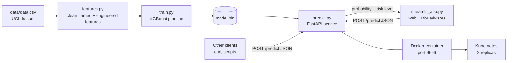

# Student Dropout Prediction

*ML Zoomcamp midterm project by **Muhammad Elias Muhammadi***

A machine learning service that estimates how likely a university student is to drop out, using the information
the university already has by the end of the student's first year. The model is an XGBoost classifier
served through a FastAPI web service, with a small Streamlit web UI on top, all packaged with Docker.

---

## Why I picked this problem

I've seen friends start university full of motivation and then quietly disappear after the first year. By the time
anyone notices, it's usually too late to help. What struck me is that the warning signs are almost always there in
the data: failed units, unpaid fees, grades sliding from one semester to the next. Universities collect all of this,
but nobody is looking at it in a systematic way.

So the question I wanted to answer is:

> **Given what we know about a student at the end of their first year, how likely are they to drop out?**

## How the model would be used

I imagine this running inside a university's student-support office:

1. At the end of each academic year, the student records are sent to the `/predict` endpoint.
2. Every student gets a **dropout probability** and a **risk level** (`low`, `medium`, `high`).
3. Advisors start with the `high` risk list and reach out: tutoring, a conversation about finances,
   a change of course, whatever fits.

The model doesn't decide anything about a student. It helps a small support team spend its limited time on the students
who most likely need it. That's also why I care more about ranking students well (ROC AUC) than about raw accuracy.

---

## Dataset

**[Predict Students' Dropout and Academic Success](https://archive.ics.uci.edu/dataset/697/predict+students+dropout+and+academic+success)**,
UCI Machine Learning Repository (Realinho, Vieira Martins, Machado & Baptista, 2021), licensed CC BY 4.0.

- 4,424 students from a Portuguese higher-education institution, across 17 undergraduate degrees
- 36 features: demographics, family background, admission info, tuition and scholarship status,
  first- and second-semester academic results, and macro-economic indicators (unemployment, inflation, GDP)
- Original target: `Dropout` (32.1%), `Enrolled` (17.9%), `Graduate` (49.9%)

I turned it into a **binary problem**: `dropout = 1` if the student dropped out, `0` otherwise. That's the question a
support office actually needs answered.

The dataset is committed in [`data/data.csv`](data/data.csv) (about 520 KB), so you don't need to download anything.
If you want to fetch it yourself:

```bash
curl -L -o data.zip "https://archive.ics.uci.edu/static/public/697/predict+students+dropout+and+academic+success.zip"
unzip data.zip -d data/
```

---

## What I found in the data (EDA summary)

The full analysis is in [`notebook.ipynb`](notebook.ipynb). The highlights:

- **Clean data.** No missing values and no duplicate rows. The only cleanup was the column names: one has a hidden tab
  character and "nationality" is misspelled as `Nacionality`. I map all of them to snake_case in [`features.py`](features.py).
- **Many "numbers" are really categories.** Columns like `course`, `nationality` or `mothers_occupation` are integer codes,
  so I one-hot encode them instead of treating them as numeric.
- **Money matters a lot.** Students with **tuition fees not up to date** drop out **86.6%** of the time, against 24.7% for
  those who are up to date. Debtors drop out at 62%, scholarship holders at only 12.2%.
- **First-year results are the strongest signal.** Measured by single-feature ROC AUC, the best predictor is the share of
  second-semester units a student passed (0.874), followed by second-semester approved units (0.855) and the
  first-semester approval rate (0.840).
- **Course matters.** Dropout ranges from 15.4% in Nursing to over 50% in Informatics Engineering, Equinculture and
  evening Management.
- **Age matters.** Older students at enrolment are more likely to leave (single-feature AUC 0.671).
- **The economy barely matters on its own.** Unemployment, inflation and GDP all score between 0.51 and 0.54.

### Feature engineering

I kept this deliberately small and easy to explain:

| Feature | Definition | Why |
|---|---|---|
| `sem1_approval_rate` | approved units / enrolled units (1st semester) | Passing 5 of 6 units is very different from passing 5 of 12 |
| `sem2_approval_rate` | the same for the 2nd semester | Turned out to be the single best feature |
| `grade_change` | 2nd-semester grade − 1st-semester grade | Catches students who are slipping |

---

## Modelling

I held out 20% of the data as a test set and did all model selection with **5-fold stratified cross-validation** on the
remaining 80%. Every model is a scikit-learn pipeline: `DictVectorizer` (one-hot encoding) followed by the model.

| Model | CV AUC (default) | CV AUC (tuned) | Best parameters |
|---|---|---|---|
| **XGBoost** | 0.9085 | **0.9207** | `n_estimators=400, learning_rate=0.03, max_depth=4, min_child_weight=1, subsample=0.8, colsample_bytree=0.8` |
| Logistic regression | 0.9115 | 0.9186 | `C=0.01` (with standard scaling) |
| Random forest | 0.9171 | 0.9181 | `n_estimators=300, max_depth=20, max_features="sqrt", min_samples_leaf=1` |
| Decision tree | 0.7850 | 0.8960 | `max_depth=5, min_samples_leaf=50` |

A few things I learned along the way:

- The untuned decision tree overfits badly (0.785). Limiting depth and leaf size makes a huge difference.
- Logistic regression is a really strong baseline here. With strong regularisation it gets within 0.002 of the best
  model, which tells me most of the signal is fairly "linear" (pass more units, drop out less).
- XGBoost's defaults overfit a bit. Shallower trees with a smaller learning rate and more trees gave the best result.

I picked **XGBoost** because it had the best cross-validated AUC.

### Decision threshold

The model outputs a probability. To turn it into a yes/no flag I picked the threshold that maximises F1, computed on
out-of-fold predictions from the training data (so the test set stayed untouched). The threshold is **0.473**.

### Final results on the held-out test set (885 students)

| Metric | Value |
|---|---|
| ROC AUC | **0.943** |
| F1 (dropout class) | 0.831 |
| Precision (dropout) | 0.860 |
| Recall (dropout) | 0.803 |
| Accuracy | 0.895 |

In plain words: of the 284 students in the test set who actually dropped out, the model flagged 228 of them, and when it
flags someone it's right 86% of the time.

The test AUC is a bit higher than the CV AUC (0.943 vs 0.921). That's within normal variation between splits (the CV
folds themselves vary by about ±0.012), and what matters is that the test score isn't *lower*.

For the deployed model, `train.py` refits on all 4,424 students after evaluation, so the service learns from every example.

---

## Architecture



The key design choice is that **`features.py` is shared** by the notebook, the training script and the API. That way
the features are built exactly the same way at training time and at prediction time.

## Project structure

```
.
├── README.md               <- you are here
├── notebook.ipynb          <- data cleaning, EDA, feature importance, model selection and tuning
├── features.py             <- data loading + feature engineering (shared everywhere)
├── train.py                <- trains the final model and saves model.bin
├── predict.py              <- FastAPI web service (/predict and /health)
├── streamlit_app.py        <- web UI (form) that calls the FastAPI service
├── test_service.py         <- sends the example students to a running service
├── model.bin               <- trained model (pickle)
├── data/data.csv           <- the dataset
├── examples/               <- two real students from the dataset, as JSON requests
├── tests/                  <- pytest tests for features and the API
├── pyproject.toml, uv.lock <- dependencies (uv)
├── requirements.txt        <- same runtime dependencies for plain pip
├── Dockerfile              <- API image
├── Dockerfile.ui           <- UI image
├── docker-compose.yml      <- runs API + UI together
├── k8s/                    <- Kubernetes manifests + deploy script for a local kind cluster
└── course-instructions/    <- the original ML Zoomcamp project instructions
```

---

## How to run it

I used **Python 3.12** and **[uv](https://docs.astral.sh/uv/)** for dependencies and the virtual environment.
Everything below was tested on a clean copy of the repo.

### 1. Get the code and set up the environment

```bash
git clone <this-repo-url>
cd <repo-folder>
```

**Option A, uv (recommended).** It creates `.venv` and installs the exact versions from `uv.lock`:

```bash
pip install uv
uv sync
```

Then either prefix commands with `uv run` (e.g. `uv run python train.py`) or activate the environment:

```bash
source .venv/bin/activate        # Linux / macOS
.venv\Scripts\activate           # Windows
```

**Option B, plain pip + venv** (runtime dependencies only, enough for training and serving):

```bash
python -m venv .venv
source .venv/bin/activate        # Windows: .venv\Scripts\activate
pip install -r requirements.txt
```

### 2. Train the model

```bash
uv run python train.py
```

Expected output:

```
train rows: 3539 | test rows: 885
threshold: 0.4734 | test ROC AUC: 0.9427 | test F1: 0.8306
saved model to .../model.bin
```

A trained `model.bin` is already in the repo, so this step is optional.

### 3. Explore the notebook (optional)

```bash
uv run jupyter notebook notebook.ipynb
```

If GitHub doesn't render it, use [nbviewer](https://nbviewer.org/).

### 4. Start the web service

```bash
uv run uvicorn predict:app --host 0.0.0.0 --port 9696
```

FastAPI also generates interactive docs at **http://localhost:9696/docs**, where you can try the API from the browser.

### 5. Send a request

In another terminal:

```bash
uv run python test_service.py
```

```
GET  http://127.0.0.1:9696/health -> {'status': 'ok'}
POST http://127.0.0.1:9696/predict (student_at_risk.json) -> {'dropout_probability': 0.6748, 'dropout_risk': True, 'risk_level': 'high', 'threshold': 0.4734}
POST http://127.0.0.1:9696/predict (student_on_track.json) -> {'dropout_probability': 0.0841, 'dropout_risk': False, 'risk_level': 'low', 'threshold': 0.4734}
```

Both example students are real rows from the dataset: the first one actually dropped out, the second one graduated.

Or with `curl`:

```bash
curl -X POST http://localhost:9696/predict \
     -H "Content-Type: application/json" \
     -d @examples/student_on_track.json
```

### 6. Run the tests

```bash
uv run pytest
```

11 tests cover the feature engineering (including the divide-by-zero case), the health check, predictions for both
example students, and input validation.

---

## Web UI (Streamlit)

Sending JSON is fine for testing, but an advisor isn't going to write `curl` commands. So I added a small web UI in
[`streamlit_app.py`](streamlit_app.py). It's a form, with course and marital status shown by name, yes/no drop-downs and
range-limited number fields. It sends the student to the FastAPI `/predict` endpoint and shows the result as a
colour-coded risk level with the probability.

The UI does **not** load the model itself. It only calls the API, so the model is served from one place and the UI is
just a client, like `curl`. FastAPI + Docker is still the real deployment; Streamlit is an extra on top.

What you can do in it:

- Start from one of the two real example students in the sidebar (one who dropped out, one who graduated) and change
  any field to see how the risk moves. Try setting "Tuition fees up to date" to *No* on the on-track student.
- See whether the API is online, in the sidebar.
- If something goes wrong (API down, invalid input) you get a readable message instead of a stack trace.

**Run it locally** (with the API from step 4 running in another terminal):

```bash
uv sync --group ui
uv run --group ui streamlit run streamlit_app.py
```

Then open **http://localhost:8501**. By default the UI talks to `http://127.0.0.1:9696`. To point it somewhere else,
set the `API_URL` environment variable.

I pinned Streamlit to 1.50.0 because newer versions need a newer Starlette than the FastAPI version this project uses.

**Run API + UI together with Docker Compose** (the easiest way to try everything):

```bash
docker compose up --build
```

- UI: http://localhost:8501
- API: http://localhost:9696 (docs at http://localhost:9696/docs)

The UI container waits until the API container passes its health check before starting. Stop everything with
`docker compose down`.

---

## API reference

| Method | Path | Description |
|---|---|---|
| `GET` | `/health` | Returns `{"status": "ok"}` |
| `POST` | `/predict` | Takes one student as JSON, returns the dropout prediction |

**Response:**

```json
{
  "dropout_probability": 0.0841,
  "dropout_risk": false,
  "risk_level": "low",
  "threshold": 0.4734
}
```

- `dropout_risk` is `true` when the probability is at or above the threshold
- `risk_level`: `low` below the threshold, `medium` from the threshold up to threshold + 0.2, `high` above that

**Input:** all 36 fields are required, and unknown fields are rejected. Each field is range-checked, so for example a
grade of 35 on a 0–20 scale returns `422 Unprocessable Entity` with a message saying which field is wrong.
See [`examples/student_on_track.json`](examples/student_on_track.json) for a full request, and `/docs` for every
field with its allowed range. Categorical fields (`course`, `application_mode`, `nationality`, parents' qualification and
occupation, ...) use the integer codes from the
[UCI dataset page](https://archive.ics.uci.edu/dataset/697/predict+students+dropout+and+academic+success).

---

## Docker

The image installs only the runtime dependencies, pinned by `uv.lock`, and runs as a non-root user.

```bash
docker build -t dropout-api:v1 .
docker run -it --rm -p 9696:9696 dropout-api:v1
```

Then, from another terminal:

```bash
python test_service.py
```

The image is about 900 MB. Most of that is the NVIDIA NCCL library that the Linux `xgboost` wheel brings in, even
though this project only uses the CPU.

To run the API together with the Streamlit UI, use `docker compose up --build` (see [Web UI](#web-ui-streamlit)).
The UI image ([`Dockerfile.ui`](Dockerfile.ui)) only installs Streamlit and doesn't contain the model.

---

## Deployment to Kubernetes

The [`k8s/`](k8s/) folder has a Deployment (2 replicas, readiness and liveness probes on `/health`, CPU/memory limits)
and a Service. [`k8s/deploy-kind.sh`](k8s/deploy-kind.sh) does the whole thing on a local
[kind](https://kind.sigs.k8s.io/) cluster: it builds the image, creates the cluster, loads the image, applies the
manifests, waits for the rollout, and sends the test requests through a port-forward.

You need `docker`, `kind` and `kubectl`:

```bash
bash k8s/deploy-kind.sh
```

Or step by step:

```bash
docker build -t dropout-api:v1 .
kind create cluster --name dropout
kind load docker-image dropout-api:v1 --name dropout
kubectl apply -f k8s/deployment.yaml -f k8s/service.yaml
kubectl rollout status deployment/dropout-api
kubectl port-forward service/dropout-api 9696:80
python test_service.py          # in another terminal
```

When you're done, delete the cluster so nothing keeps running:

```bash
kind delete cluster --name dropout
```

The same manifests work on a managed cluster (EKS, GKE, AKS). Push the image to a registry and change the `image:`
field in `k8s/deployment.yaml`.

<!-- Screenshot of the kind deployment + test requests goes here: images/k8s-test.png -->

---

## Limitations and what I'd do next

- **Timing.** The model needs end-of-first-year data, so it can't flag students on day one. A second model that uses
  only admission data would be a nice complement, even if it's less accurate.
- **One institution.** All the students come from a single Portuguese institution. Before using this anywhere else
  I'd retrain on that university's own data.
- **Fairness.** `gender`, `age_at_enrollment` and `nationality` are model inputs. They improve accuracy, but before
  real use I'd check that the error rates are similar across groups, and consider dropping those features if they're
  not.
- **"Enrolled" students.** Some students labelled `Enrolled` may still drop out later, so part of the "not dropout"
  class is noisy.
- **Surprises worth investigating.** Course `171` (Animation and Multimedia Design) and the "unknown" parental
  qualification codes rank high in the model's feature importance. I'd want to understand why before trusting it fully.
- **Next steps:** SHAP values, so advisors can see *why* a student was flagged; a batch endpoint for scoring a whole
  cohort at once; a 3-class version that separates "still enrolled" from "graduated".

---

## Evaluation criteria checklist

For reviewers, here's where to find each part:

| Criterion | Where |
|---|---|
| Problem description | [Why I picked this problem](#why-i-picked-this-problem), [How the model would be used](#how-the-model-would-be-used) |
| EDA | `notebook.ipynb` sections 1–2: ranges, missing values, target analysis, feature importance (mutual information + single-feature AUC) |
| Model training | `notebook.ipynb` section 4: 4 models (linear + 3 tree-based), each tuned with grid search |
| Exporting notebook to script | [`train.py`](train.py) |
| Reproducibility | Dataset committed; `uv sync` + `python train.py` reproduces the exact numbers |
| Model deployment | [`predict.py`](predict.py), FastAPI (plus [`streamlit_app.py`](streamlit_app.py) as a UI on top) |
| Dependency and environment management | `pyproject.toml` + `uv.lock` (and `requirements.txt`); setup steps in [How to run it](#how-to-run-it) |
| Containerization | [`Dockerfile`](Dockerfile), [`docker-compose.yml`](docker-compose.yml); build and run steps in [Docker](#docker) |
| Cloud deployment | [`k8s/`](k8s/) manifests + script; steps in [Deployment to Kubernetes](#deployment-to-kubernetes) |

---

## Acknowledgements

- Dataset: Realinho, V., Vieira Martins, M., Machado, J., & Baptista, L. (2021). *Predict Students' Dropout and
  Academic Success* [Dataset]. UCI Machine Learning Repository.
- [DataTalks.Club](https://datatalks.club/) and Alexey Grigorev for the ML Zoomcamp course.

If you have feedback on the project, I'd really like to hear it. Thanks for reviewing!

— Muhammad Elias Muhammadi
